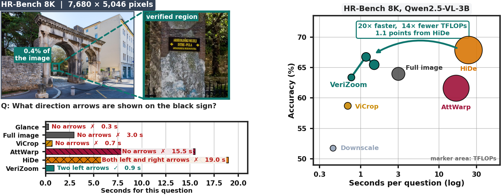
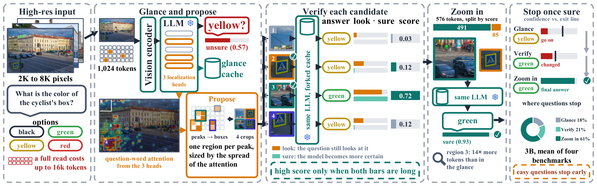
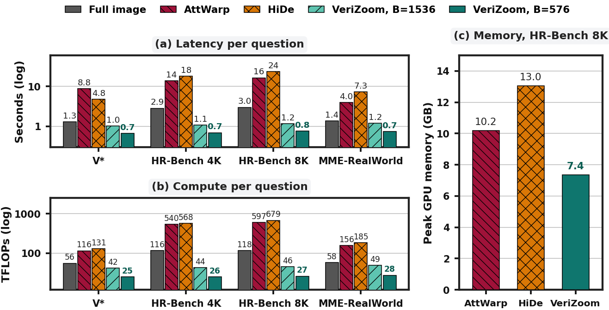
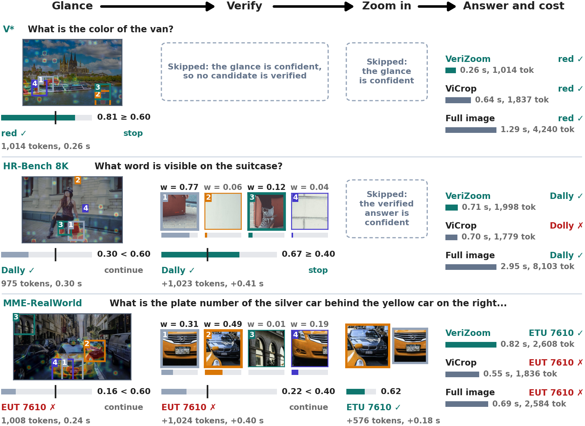
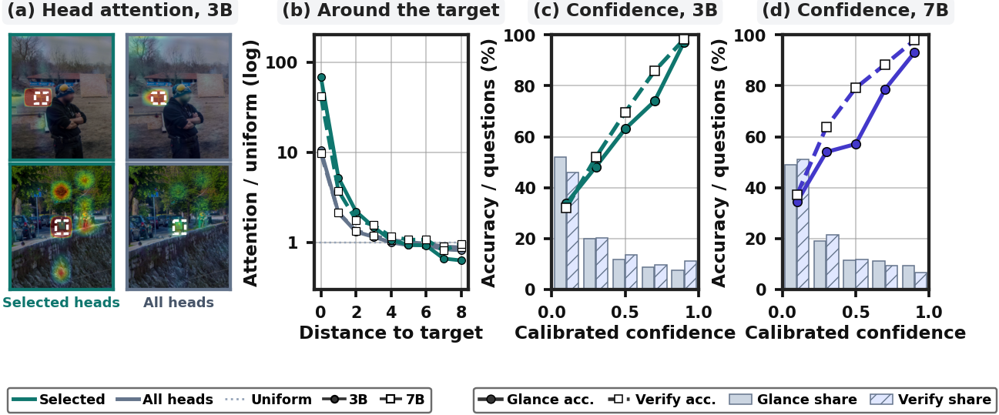

# Verify Before You Zoom

**Training-free high-resolution visual question answering.** VeriZoom glances at a high-resolution image at low resolution, proposes candidate regions from a few localization heads, verifies every candidate on a fork of the cached glance, and reads only the verified regions at high resolution. Each stage stops as soon as its calibrated confidence is high enough.

<p align="center"></p>

## Method

<p align="center"></p>

| Stage | What it does | Cost |
|---|---|---|
| **Glance** | Reads the image at 1,024 tokens. A few localization heads turn the attention of the question words into a proposal map. | one prefill |
| **Verify** | Each of the K=4 candidates is read on its own fork of the glance cache and weighted by its attention share and confidence gain. | 4 short forks |
| **Zoom in** | Only the verified regions are read at higher resolution (B=576 tokens). | one fork |
| **Exit** | A calibrated confidence after each stage decides whether to stop. | none |

The localization heads, exit thresholds and read form are all selected on the MME-RealWorld training split. No weights are trained.

## Results

Accuracy (%), TFLOPs and latency (s) per question. HR-Bench is averaged over its four option rotations.

| Qwen2.5-VL-3B | V* | HR-4K | HR-8K | MME-RW | Avg. | TFLOPs | Latency |
|---|:-:|:-:|:-:|:-:|:-:|:-:|:-:|
| Downscale (1,600 tokens) | 67.5 | 63.6 | 51.8 | 39.2 | 55.5 | 18.2 | 0.4 |
| Full image (8,192 tokens) | 76.4 | 68.0 | 64.0 | 41.4 | 62.5 | 87.1 | 2.1 |
| ViCrop | 73.3 | 65.4 | 58.8 | 40.0 | 59.4 | 27.1 | 0.6 |
| AttWarp | 72.3 | 65.5 | 61.6 | 40.3 | 59.9 | 352 | 10.8 |
| HiDe | **78.5** | **69.8** | **67.9** | 41.9 | **64.5** | 391 | 13.4 |
| **VeriZoom** (B=576) | 75.4 | 66.9 | 63.4 | **43.1** | 62.2 | 26.4 | 0.7 |
| **VeriZoom** (B=1536) | 78.0 | 68.6 | 66.8 | 41.7 | 63.8 | 45.3 | 1.1 |

| Qwen2.5-VL-7B | V* | HR-4K | HR-8K | MME-RW | Avg. | TFLOPs | Latency |
|---|:-:|:-:|:-:|:-:|:-:|:-:|:-:|
| Downscale (1,600 tokens) | 70.7 | 63.4 | 56.0 | 45.0 | 58.8 | 30.6 | 0.4 |
| Full image (8,192 tokens) | **82.7** | **70.9** | **66.2** | **47.5** | **66.8** | 137 | 1.6 |
| ViCrop | 82.2 | 65.8 | 60.6 | 45.4 | 63.5 | 50.2 | 0.6 |
| **VeriZoom** (B=576) | 79.1 | 68.9 | 63.1 | 46.8 | 64.5 | 41.2 | 0.7 |

| Newer models | V* | HR-4K | HR-8K | MME-RW | Avg. | Latency |
|---|:-:|:-:|:-:|:-:|:-:|:-:|
| Qwen3-VL-8B, glance | 68.6 | 67.9 | 62.9 | 45.2 | 61.1 | 0.25 |
| Qwen3-VL-8B, **VeriZoom** | 80.1 | 74.4 | 69.9 | 49.2 | 68.4 | 0.60 |
| Qwen3.5-9B, glance | 73.8 | 67.2 | 61.5 | 51.7 | 63.6 | 0.37 |
| Qwen3.5-9B, **VeriZoom** | 83.8 | 74.0 | 68.0 | 53.2 | 69.7 | 0.67 |

Latency: RTX 5080 for 3B, A800 for 7B and the newer models, one job per GPU.

<p align="center"></p>

**Inference traces.** One question per exit stage, with the confidence, tokens and seconds of every stage next to ViCrop and the full image.

<p align="center"></p>

**Where the heads look.** On V*, the selected heads put 68× (3B) and 41× (7B) a uniform share of their attention on the annotated target, against about 10× for the average head.

<p align="center"></p>

## Setup

```bash
pip install -r requirements.txt          # Qwen3.5 needs transformers>=5 in a separate environment
bash run/prepare.sh                      # models, V*, HR-Bench, MME-RealWorld(-Lite), training split
```

Baselines use the official code, unmodified:

```bash
git clone https://github.com/Tennine2077/HiDe.git external/HiDe          # c7d2116
git clone https://github.com/dwipddalal/Attwarp.git external/Attwarp    # 5c7aef0
```

## Run

```bash
# selection on the training split, the four benchmarks, and the whole-image / ViCrop baselines
bash run/pipeline.sh h    models/Qwen2.5-VL-3B-Instruct 28
bash run/pipeline.sh 7b   models/Qwen2.5-VL-7B-Instruct 28 "--offload embed head"
bash run/pipeline.sh q3vl models/Qwen3-VL-8B-Instruct  32
bash run/pipeline.sh q35  models/Qwen3.5-9B            32

# HiDe and AttWarp (Qwen2.5-VL-3B)
python scripts/baseline_hide.py    --dataset vstar
python scripts/baseline_attwarp.py --dataset vstar

# latency on an idle GPU, same questions for every method
bash run/latency.sh q3vl models/Qwen3-VL-8B-Instruct "21:10 21:11 18:21" warp 32

# tables and figures of the paper -> outputs/
python scripts/plot_verizoom.py numbers tables cross_table efficiency results analysis insight trace
```

The selected configurations of every model are in `runs/fovea/mmerwtrain/*_config.json`.

## Layout

```
vzcore/      model adapters (Qwen2.5-VL, Qwen3-VL, Qwen3.5), KV cache with forks, decoder with attention hooks
fovea/       canvas: images and crops laid out in one prompt
scripts/     fovea_cascade.py      VeriZoom (glance, verify, zoom; all stages stored)
             fovea_cascade_an.py   calibration and exit selection on the training split
             fovea_head_sweep.py   per-head scores on the training split -> fovea_rank_heads.py
             fovea_open*.py        open-ended answers
             baseline_*.py         full image / downscale, HiDe, AttWarp;  fovea_e2e.py: ViCrop
             head_target_mass.py   attention of every head on the annotated V* targets
             plot_verizoom.py      all tables and figures
run/         data preparation, full pipeline, latency
data_splits/ MME-RealWorld training split (disjoint from MME-RealWorld-Lite)
```
